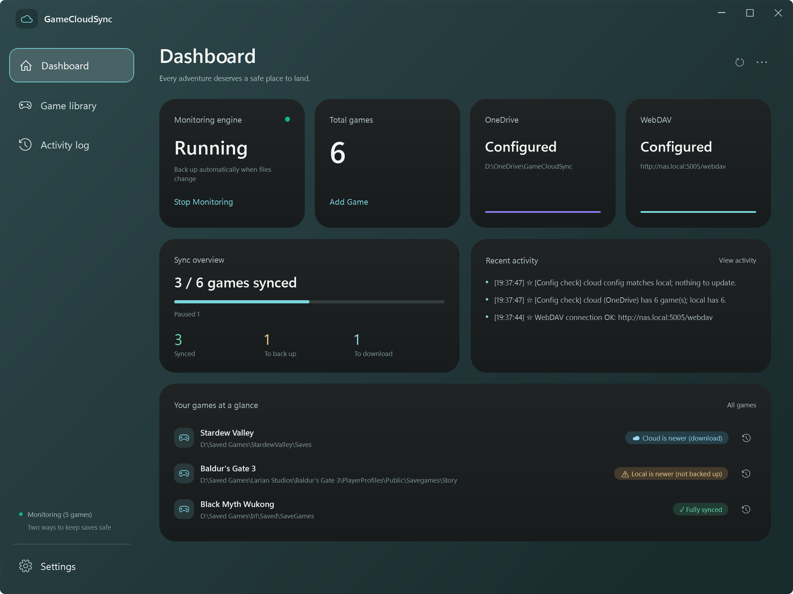
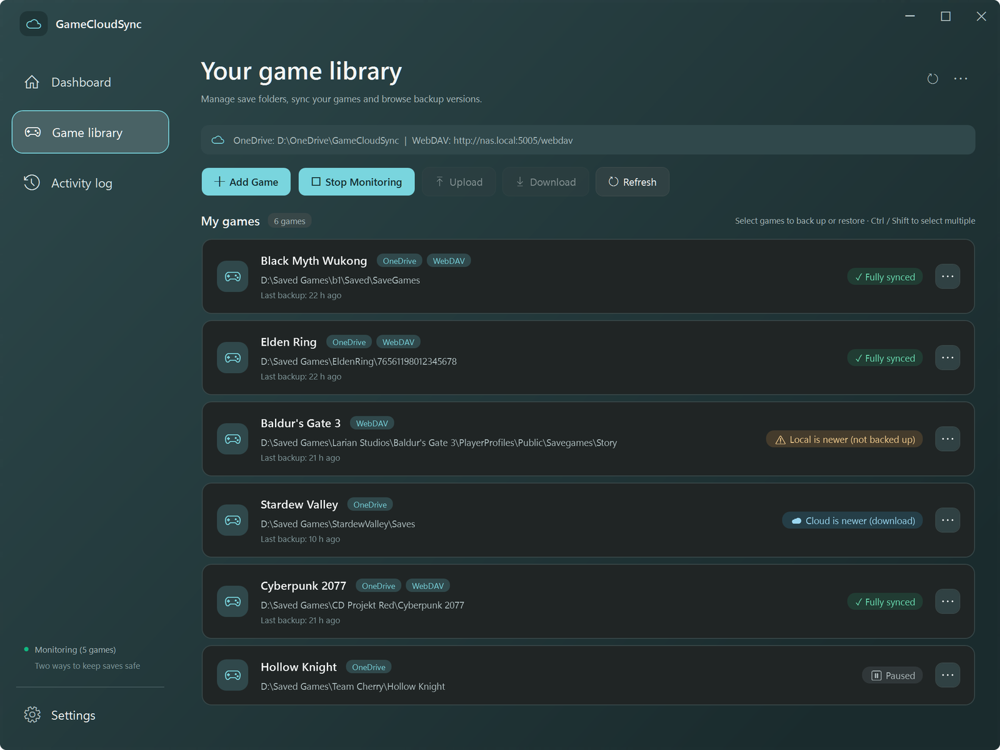

# GameCloudSync — Cloud Save Manager

[](https://github.com/B-lackLuster/GameCloudSync/actions/workflows/ci.yml)
[](https://github.com/B-lackLuster/GameCloudSync/releases/latest)

[简体中文](README.md) | English

A Windows app that watches each game's save folder and backs every new save up to OneDrive and/or WebDAV, so you can carry on playing on another PC and get any earlier version back.



## Highlights

- **Automatic backups**: a save is backed up 5 seconds after its folder stops changing; nothing to do while you play
- **Two targets**: OneDrive (in fact any locally synced folder) and WebDAV (Nutstore, a NAS, …), either one or both
- **Backup history**: the latest 10 backups per game are kept (adjustable); restore, download or delete any of them
- **Several PCs**: each PC remembers where it last synced; if both this PC and the cloud changed since then, you are asked instead of the newer one simply winning
- **Safe restores**: the local save is snapshotted before it is overwritten, and a failed restore leaves it untouched
- **Failures you can see**: Windows notifications, a red tray icon, a dashboard banner and the reason on the game card; failed backups are retried automatically
- **Low maintenance**: one portable exe, no installer; lives in the tray, starts with Windows; Chinese and English UI

## Download

Get `GameCloudSync.exe` from [Releases](https://github.com/B-lackLuster/GameCloudSync/releases/latest), put it in any folder and run it. It is a self-contained single file; no .NET installation is needed.

- Requires Windows 10 / 11 (64-bit)
- To upgrade, right-click the tray icon and choose "Quit", then replace the old exe with the new one; your settings, WebDAV password and cloud backups carry on

## Getting started

1. **Connect your cloud storage**: click "Settings" at the bottom left
   - OneDrive: click "Detect" to fill in a `GameCloudSync` folder inside your OneDrive (created when you save the settings), or pick any folder with "Browse..."
   - WebDAV: enter the server URL, username and password, then click "Test WebDAV Connection"
   - One of the two is enough
2. **Add a game**: on the "Game library" page click "Add Game", enter the game's name, pick its local save folder and tick the backup methods (OneDrive / WebDAV)
3. **Start monitoring**: after adding your first game, click "Start Monitoring" on the dashboard's "Monitoring engine" card (from then on it starts by itself whenever the app opens). Once it says "Running", every save the game writes reaches the cloud a few seconds later

You can close the window afterwards; the app keeps working in the tray.

## A tour of the app

The sidebar holds the "Dashboard", "Game library" and "Activity log" pages and "Settings"; refresh and "Configuration tools" (⋯) sit at the top right. Switching pages, minimizing and maximizing are animated (following Windows' "Animation effects" setting).

### Dashboard

- **Four status cards**: the monitoring engine (start or stop it right there), the number of games (add one), and whether OneDrive and WebDAV are configured
- **Sync overview**: how many games are synced, with the counts for "Synced / To back up / To download"; paused games, games changed on both sides, games without saves and so on are listed under the bar
- **Recent activity**: the latest three entries; "View activity" opens the Activity log page
- **Your games at a glance**: games that need something come first; the button beside each one opens its backup history
- When a game's backups fail or can't run, a red banner at the top says which game and why

### Game library



- The bar at the top shows the OneDrive folder and the WebDAV address, followed by "Add Game", "Start / Stop Monitoring", "Upload", "Download" and "Refresh"
- Each game has a card: its name, backup methods, save path, the time of its last backup (or why it failed) and its sync status; hover over the status for details
- Hold Ctrl / Shift to select several games and upload or download them at once; a batch download skips games whose local save is newer than the cloud
- While an upload or restore is running, a bar above the list shows which game it is on, with "Cancel"
- When the cloud config has games this PC doesn't, an "⬆ Update Config" button appears

Click "⋯" on a card, or right-click it, for the game menu:

| Menu item | What it does |
| --- | --- |
| Upload / Download | Back up now; or overwrite the local save with a cloud backup (after a confirmation that shows the local and the cloud time) |
| 📂 Open Local Save Folder / ☁ Open Cloud Save Folder | Opens the save folder or its cloud backup folder in Explorer (WebDAV opens in the browser) |
| ⏸ Pause Sync / ▶ Resume Sync | A paused game is neither watched nor backed up |
| Backup to OneDrive / Backup to WebDAV | Switches the game's backup methods (at least one stays on) |
| 📜 View Backup History | Lists every backup on a OneDrive and a WebDAV tab: restore the selected version, delete, or download several to a local folder |
| ⏪ Restore from Pre-restore Snapshot... | Brings back a local save that a restore or download overwrote (one is saved automatically every time; the latest 5 per game are kept) |
| ✎ Edit Game Settings | Name, save path, backup methods and the number of backups to keep (1–99); a renamed game can take its cloud backup folders along |
| 📤 Export Selected Config / 🗑 Delete | Exports the selected games' config; removes the game from the list (its saves and cloud backups stay) |

### Activity log

What happened during this run (the latest 400 entries): backups, downloads, connection checks and errors. The full log is kept in the `logs` folder (about the last 2 MB), one click away; the list can also be cleared.

### Configuration tools (⋯ at the top right)

- **📤 Export All Config / 📥 Import Config**: save the game list as JSON or load one; games with the same name ask before they are replaced
- **☆ Backup Config to Cloud / ☁ Restore Config from Cloud**: the game list is kept in a `云存档配置备份` ("cloud config backups") folder in the cloud (latest 10 copies); restoring it on another PC only adds the games that PC doesn't have and leaves existing ones as they are

### Settings

| Section | Options |
| --- | --- |
| OneDrive Settings | Cloud root: "Detect" or "Browse..." |
| WebDAV Settings | Server URL, username, password; "Test WebDAV Connection" |
| Backup Retention | Default backups (new games keep 10; each game can change its own) |
| Download Preferences | Default download source, config update source: OneDrive first / WebDAV first / Ask me each time |
| Run Options | Language (中文 / English), start with Windows, run in background (minimize to tray when closing), auto backup/download on startup, auto-save game config to cloud, WebDAV debug log |

The WebDAV password is encrypted with Windows DPAPI and never written to the config file.

### Tray icon

- Gray: not monitoring; green: monitoring; red: a game needs attention. A failed background backup also raises a Windows notification
- Double-click to open the window; right-click for "Show Main Window", "Monitor saves (auto backup)" and "Quit"
- Only one copy runs: starting the exe again brings up the window of the one already running
- With "Start with Windows" on, the app starts straight into the tray when you sign in, without opening its window

### Shortcuts

<kbd>F5</kbd> refreshes · <kbd>Ctrl</kbd>+<kbd>N</kbd> adds a game · <kbd>Del</kbd> deletes the selected games (in the game library)

## Sync status

| Status | Meaning | What to do |
| --- | --- | --- |
| ✓ Fully synced | The local save matches the newest cloud backup | Nothing |
| ⚠ Local is newer (not backed up) | There is a new local save that hasn't been backed up | Monitoring backs it up; or "Upload" |
| ☁ Cloud is newer (download) | The cloud holds a newer backup, e.g. from another PC | "Download" |
| ☁ No local save (downloadable) | This PC has no save yet, the cloud has a backup | "Download" |
| ⚠ Changed on both sides | Both this PC and the cloud got new saves since the last sync | Decide which one to keep; the other isn't lost |
| Waiting for first backup... | There is no backup yet | Wait for the automatic backup, or "Upload" |
| ⏸ Paused | Sync is paused | "▶ Resume Sync" in the game menu |
| ⛔ … | Invalid save path, OneDrive folder missing, WebDAV login failed or unreachable, … | Hover over the status for the reason and fix the setting it names |

## How it works

### Automatic backups

- A save is backed up 5 seconds after its folder stops changing; while a game keeps writing, the backup waits at most 120 seconds
- One game is backed up at a time; a save made during a running backup is queued for the next one, never dropped
- A target that already holds the same content is skipped
- Failed backups are retried after 30 seconds, 2 minutes, 10 minutes, 30 minutes and 1 hour
- A backup is written as `incomplete_save_…` and renamed to `save_…` only once complete, so an interrupted backup is never taken for the newest one
- Only the latest N backups per game are kept (10 by default); older ones are cleaned up

### Cloud layout

One folder per game; every backup is a full, uncompressed copy of the save folder, so it can be opened straight from the cloud drive:

```text
OneDrive cloud root\
├── Stardew Valley\
│   ├── save_20261102_091200\
│   └── save_20261101_215800\
└── 云存档配置备份\
    └── config_20261102_093000.json

WebDAV address/
├── Stardew Valley/
│   └── save_20261101_215800_mtime1793541360/   ← the save time is part of the name
└── 云存档配置备份/
```

Since game names become folder names, they can't contain `\ / : * ? " < > |` or match another game's name (case-insensitively).

### Several PCs

- For each game the app remembers the save time it last synced on this PC (`sync-state.json`)
- It compares the modification times of the local save and the newest cloud backup (within 3 seconds counts as equal): only the cloud changed means "To download", only the local save changed means "To back up", both changed means "Changed on both sides"
- With "Auto backup/download on startup" on, the app uploads games that are newer locally and downloads games that are newer in the cloud when it opens; for a game changed on both sides it asks: keep this PC's save, use the cloud backup, or skip for now

### Restoring

- Before a local save is overwritten, it is kept as a pre-restore snapshot (the latest 5 per game)
- A cloud backup is first downloaded to a temporary folder and only replaces the local save once complete; if that fails halfway, the original save stays as it was

### Save paths

- In "Add Game" and "Edit Game Settings", a save path may be written like `%APPDATA%\StardewValley\Saves`; it is expanded to this PC's full path when saved
- When a config from another PC is imported or restored from the cloud, `C:\Users\<their user name>\` in its paths is switched to this PC's user folder
- Folders that are far too broad are refused — a whole drive, the user profile, Documents, AppData, Program Files and the like — because backups and restores always cover the whole folder; so are the OneDrive backup folder itself and the folders above it

### Where data is kept

Next to the exe by default (portable). If that folder can't be written (for example under Program Files), everything goes to `%APPDATA%\GameCloudSync` instead, taking a config already beside the exe along.

| File | Contents |
| --- | --- |
| `config.json` | Settings and the game list; `config.json.bak` is the last successfully saved copy, used automatically if the config gets damaged |
| `.gcs_webdav.cred` | The encrypted WebDAV password, readable only by the current Windows user |
| `sync-state.json` | The save time each game was last synced at |
| `logs\gamecloudsync.log` | The run log (about 1 MB per file, plus one older file) |
| `restore-snapshots\` | Pre-restore snapshots |

## FAQ

**Does the app keep running after I close the window?**
Yes. By default closing the window only sends it to the tray, and monitoring and backups carry on; to exit, right-click the tray icon and choose "Quit". If you'd rather close it for good, untick "Run in background" in Settings.

**WebDAV says the login failed?**
Check the username and password. Some services (Nutstore, for one) want a password generated for third-party apps rather than your account password.

**Does the OneDrive target have to be OneDrive?**
No. It is simply a local folder that backups are copied into and the sync client uploads. Any synced folder, an external drive or a mapped NAS share works too.

## Upgrading from older versions

- v2.x: replace the exe with the new one
- The Python version (v1.x): put your old `config.json` next to the exe; its fields are fully compatible, and the WebDAV password is moved to encrypted storage automatically
- Backup folder naming is unchanged, so old and new versions see each other's backups
- The Python sources were removed from the repository; they are still in the git history (last in commit `a8bb92f`)

## Building from source

Requires the .NET 9 SDK:

```powershell
dotnet build GameCloudSync.CSharp/GameCloudSync.sln
dotnet test GameCloudSync.CSharp/GameCloudSync.sln
dotnet publish GameCloudSync.CSharp/src/GameCloudSync.App -c Release -r win-x64 --self-contained true -p:PublishSingleFile=true -p:IncludeNativeLibrariesForSelfExtract=true -p:EnableCompressionInSingleFile=true -o GameCloudSync.CSharp/publish
```

The result is `GameCloudSync.CSharp/publish/GameCloudSync.exe` (a self-contained single file; the target PC needs no .NET).

Project layout:

- `GameCloudSync.CSharp/src/GameCloudSync.Core`: core logic (config, credentials, WebDAV, backup and restore, monitoring, cloud config)
- `GameCloudSync.CSharp/src/GameCloudSync.App`: WPF UI (main window, dialogs, tray)
- `GameCloudSync.CSharp/tests`: xUnit tests, run on Windows by GitHub Actions on every push
- `docs/images`: the screenshots in this README
