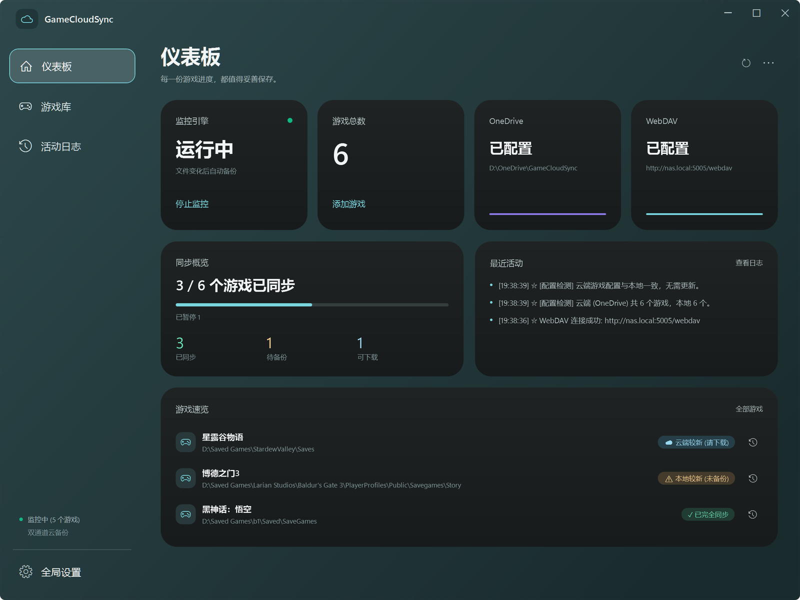
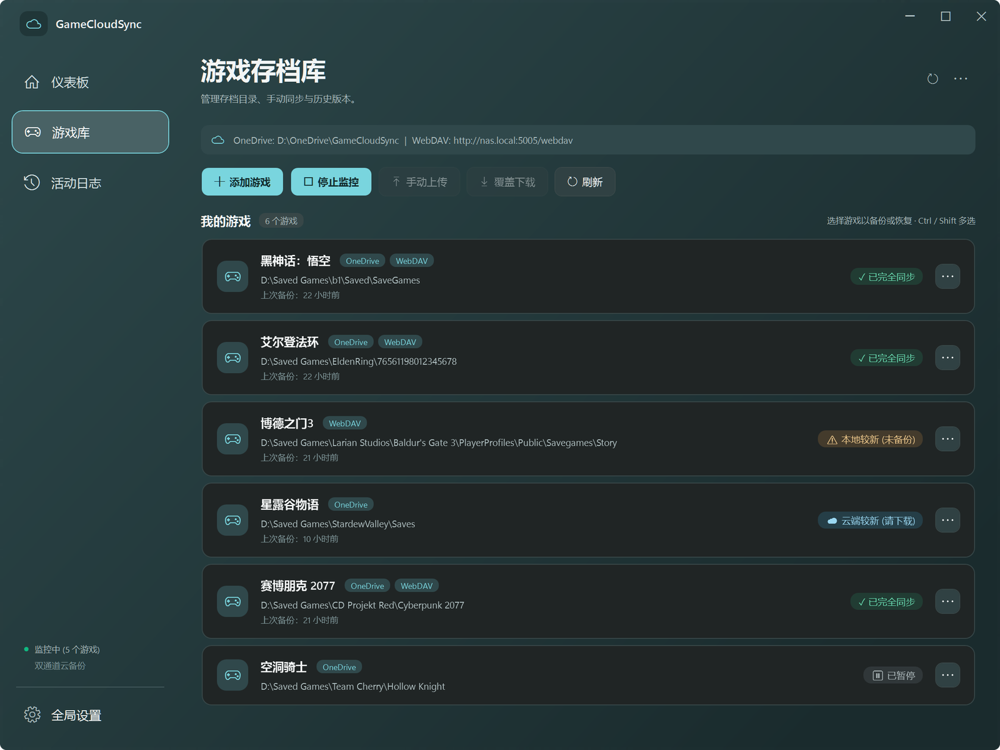

# GameCloudSync 云存档管家

[](https://github.com/B-lackLuster/GameCloudSync/actions/workflows/ci.yml)
[](https://github.com/B-lackLuster/GameCloudSync/releases/latest)

简体中文 | [English](README.en.md)

Windows 上的游戏存档自动备份工具：盯住每个游戏的存档文件夹，一有新存档就备份到 OneDrive 和 / 或 WebDAV；换一台电脑也能接着玩，任何一个历史版本都能找回来。



## 功能一览

- **自动备份**：存档文件夹停止变化 5 秒后自动备份，游戏运行时不用管它
- **双通道**：OneDrive（实际上是任意一个本地同步文件夹）和 WebDAV（坚果云、NAS 等），可以只用一个，也可以同时用
- **历史版本**：每个游戏保留最近 10 份（可改），随时恢复、下载或删除任意一份
- **多台电脑**：记得每台电脑上次同步到哪里；本机和云端都改过时先问你，不会直接拿新的覆盖旧的
- **恢复不怕错**：覆盖本地存档前自动保存一份快照，恢复失败时原存档原封不动
- **出了问题看得见**：系统通知、红色托盘图标、仪表板提示条和游戏卡片上都写明原因，失败的备份自动重试
- **省心**：单个 exe、免安装、便携；常驻托盘、开机自启；中英双语界面

## 下载

到 [Releases](https://github.com/B-lackLuster/GameCloudSync/releases/latest) 下载 `GameCloudSync.exe`，放进任意文件夹双击运行即可。它是自包含的单文件程序，不用安装 .NET。

- 系统要求：Windows 10 / 11（64 位）
- 升级：在托盘图标上右键「完全退出」，用新的 exe 替换旧的；配置、WebDAV 密码和云端备份都照常使用

## 快速上手

1. **连接云端**：点左下角「全局设置」
   - OneDrive：点「自动检测」，会填入 OneDrive 里的 `GameCloudSync` 文件夹（保存设置时自动创建）；也可以「浏览...」选择任意文件夹
   - WebDAV：填写服务器地址、用户名和密码，点「测试 WebDAV 连接」确认能连上
   - 两种配好一种就能用
2. **添加游戏**：在「游戏库」点「添加游戏」，填游戏名称，选择本地存档文件夹，勾选备份方式（OneDrive / WebDAV）
3. **自动开始监控**：添加第一个游戏后，监控会自动启动，仪表板的「监控引擎」卡片显示「运行中」（以后每次打开程序也会自动开始）。此后游戏每次存档，几秒钟后就会备份到云端

之后可以关掉窗口，程序会留在托盘里继续工作。

## 界面一览

左侧是「仪表板」「游戏库」「活动日志」三个页面和「全局设置」，右上角是刷新和「配置管理」（⋯）按钮。切换页面、最小化和最大化都有过渡动画（跟随 Windows 的「动画效果」设置）。

### 仪表板

- **四张状态卡片**：监控引擎（可直接启动 / 停止监控）、游戏总数（添加游戏）、OneDrive 和 WebDAV 是否已配置
- **同步概览**：多少个游戏已同步，以及「已同步 / 待备份 / 可下载」的数量；已暂停、两边都改过、无存档等情况列在进度条下面
- **最近活动**：最近三条记录，「查看日志」进入活动日志页
- **游戏速览**：需要处理的游戏排在最前面，右侧按钮直接打开它的历史版本
- 有游戏备份失败或无法备份时，顶部会出现红色提示条，写明是哪个游戏、什么原因

### 游戏库



- 顶部显示当前的 OneDrive 目录和 WebDAV 地址，下面是「添加游戏」「启动 / 停止监控」「手动上传」「覆盖下载」「刷新」
- 每个游戏一张卡片：名称、备份方式、存档路径、上次备份时间（备份失败时显示原因）和同步状态；鼠标停在状态上可以看到详细说明
- 按住 Ctrl / Shift 可以多选，一次上传或下载多个游戏；批量下载会跳过本地比云端新的游戏
- 正在上传或恢复时，上方会显示进度条和当前的游戏，可以随时「取消」
- 云端配置里有本机没有的新游戏时，会出现「⬆ 更新配置」按钮

点卡片右侧的「⋯」或在卡片上右键，打开游戏菜单：

| 菜单项 | 作用 |
| --- | --- |
| 手动上传 / 覆盖下载 | 立即备份；或用云端备份覆盖本地存档（先确认，并显示本地和云端各自的时间） |
| 📂 打开本地存档位置 / ☁ 打开云端存档位置 | 在资源管理器中打开存档文件夹或云端备份文件夹（WebDAV 在浏览器中打开） |
| ⏸ 暂停同步 / ▶ 恢复同步 | 暂停后不再监控和备份这个游戏 |
| 备份到 OneDrive / 备份到 WebDAV | 切换这个游戏使用的备份方式（至少保留一种） |
| 📜 查看历史备份 | 按 OneDrive / WebDAV 分页列出所有备份，可恢复选中版本、删除、或多选下载到本地文件夹 |
| ⏪ 从恢复前快照还原... | 找回被覆盖前的本地存档（每次恢复或下载前自动保存，每个游戏保留最近 5 份） |
| ✎ 修改游戏配置 | 修改名称、存档路径、备份方式和备份保留数（1–99）；改名时可以把云端备份文件夹一起改名 |
| 📤 单独导出配置 / 🗑 删除 | 导出选中游戏的配置；从列表中删除（不会删除存档和云端备份） |

### 活动日志

显示本次运行的记录（最近 400 条）：备份、下载、连接检查和错误都在这里。完整日志保存在 `logs` 文件夹（约保留最近 2 MB），可以一键打开，也可以清空当前列表。

### 配置管理（右上角 ⋯）

- **📤 导出全部配置 / 📥 批量导入配置**：游戏列表导出为 JSON，或从 JSON 导入；同名游戏会询问是否覆盖
- **☆ 备份配置到云端 / ☁ 从云端恢复配置**：游戏列表保存到云端的「云存档配置备份」文件夹（保留最近 10 份）；在另一台电脑上恢复时只添加新游戏，不会改动已有的游戏

### 全局设置

| 分组 | 选项 |
| --- | --- |
| OneDrive 设置 | 云盘根目录：「自动检测」或「浏览...」 |
| WebDAV 设置 | 服务器地址、用户名、密码；「测试 WebDAV 连接」 |
| 备份保留设置 | 默认备份数量（新游戏默认保留 10 份，每个游戏可以单独修改） |
| 下载偏好 | 默认下载来源、配置更新来源：OneDrive 优先 / WebDAV 优先 / 每次询问我 |
| 运行选项 | 界面语言（中文 / English）、开机自动启动、后台运行（关闭窗口后最小化到托盘）、打开时自动备份或下载、自动保存游戏配置到云端、WebDAV 调试日志 |

WebDAV 密码用 Windows DPAPI 加密保存，不会写进配置文件。

### 托盘图标

- 灰色：未监控；绿色：监控中；红色：有游戏需要处理。后台备份失败时还会弹出系统通知
- 双击打开主界面；右键菜单：显示主界面、监控存档（开关）、完全退出
- 程序只运行一份：再次打开 exe 会把已经在运行的窗口调出来
- 开启「开机自动启动」后，登录 Windows 时直接在托盘里启动，不弹窗口

### 快捷键

<kbd>F5</kbd> 刷新 · <kbd>Ctrl</kbd>+<kbd>N</kbd> 添加游戏 · <kbd>Del</kbd> 删除选中的游戏（在游戏库中）

## 同步状态

| 状态 | 含义 | 怎么处理 |
| --- | --- | --- |
| ✓ 已完全同步 | 本地存档和云端最新备份一致 | 不用处理 |
| ⚠ 本地较新 (未备份) | 本地有还没备份的新存档 | 监控中会自动备份，也可以「手动上传」 |
| ☁ 云端较新 (请下载) | 云端的备份比本地新，比如在别的电脑上玩过 | 「覆盖下载」 |
| ☁ 本地无档 (可下载) | 本机还没有存档，云端有备份 | 「覆盖下载」 |
| ⚠ 两边都改过 | 上次同步之后，本机和云端都有新存档 | 自己决定保留哪一份，另一份不会丢 |
| 等待首次备份... | 还没有任何备份 | 等自动备份，或「手动上传」 |
| ⏸ 已暂停 | 已暂停同步 | 游戏菜单「▶ 恢复同步」 |
| ⛔ … | 存档路径无效、OneDrive 目录不存在、WebDAV 认证失败或连不上等 | 鼠标停在状态上查看原因，按提示修改设置 |

## 工作方式

### 自动备份

- 文件夹停止变化 5 秒后备份；游戏一直在写入时，最多等 120 秒
- 一次备份一个游戏；备份进行中又有新存档，会排队等下一次，不会丢
- 云端已经是同样内容时跳过
- 备份失败会自动重试（30 秒、2 分钟、10 分钟、30 分钟、1 小时后）
- 备份先写成 `incomplete_save_…`，全部完成后才改名为 `save_…`，所以中断的备份不会被当成最新版本
- 每个游戏只保留最近 N 份（默认 10），更旧的自动清理

### 云端目录结构

每个游戏一个文件夹，每次备份是存档文件夹的完整副本（不压缩），在网盘里也能直接打开：

```text
OneDrive 云盘根目录\
├── 星露谷物语\
│   ├── save_20261102_091200\
│   └── save_20261101_215800\
└── 云存档配置备份\
    └── config_20261102_093000.json

WebDAV 地址/
├── 星露谷物语/
│   └── save_20261101_215800_mtime1793541360/   ← 名称里带着存档时间
└── 云存档配置备份/
```

游戏名会用作文件夹名，所以不能包含 `\ / : * ? " < > |`，也不能和别的游戏重名（不区分大小写）。

### 多台电脑同步

- 程序记住每个游戏在本机上次同步时的存档时间（`sync-state.json`）
- 比较本地存档和云端最新备份的修改时间（相差 3 秒以内算一致）：只有云端变了是「可下载」，只有本地变了是「待备份」，两边都变了是「两边都改过」
- 开启「打开时自动备份或下载」后，启动时自动上传本地较新的游戏、下载云端较新的游戏；遇到两边都改过的，会弹窗让你选择：保留本机存档、使用云端备份，或者这次先跳过

### 恢复存档

- 覆盖本地存档之前，先把它保存为「恢复前快照」（每个游戏保留最近 5 份）
- 云端备份先下载到临时位置，完整之后才替换本地存档；中途失败时原存档不变

### 存档路径

- 添加或修改游戏时，存档路径可以写成 `%APPDATA%\StardewValley\Saves` 这样的形式，保存时会展开为本机的完整路径
- 导入别的电脑的配置、或从云端恢复配置时，路径中的 `C:\Users\<原用户名>\` 会自动换成本机的用户目录
- 不能选择整个磁盘、用户目录、文档、AppData、Program Files 这类范围太大的文件夹（备份和恢复都是对整个文件夹操作），也不能选 OneDrive 备份目录本身或它的上级

### 数据放在哪里

默认都在 exe 所在的文件夹（便携）。如果这个文件夹不能写入（比如放在 Program Files 里），会改存到 `%APPDATA%\GameCloudSync`，并把 exe 旁已有的配置一起带过去。

| 文件 | 内容 |
| --- | --- |
| `config.json` | 设置和游戏列表；`config.json.bak` 是上一次成功保存的副本，配置损坏时自动用它恢复 |
| `.gcs_webdav.cred` | 加密后的 WebDAV 密码，只有当前 Windows 用户能解开 |
| `sync-state.json` | 每个游戏上次同步时的存档时间 |
| `logs\gamecloudsync.log` | 运行日志（每个文件约 1 MB，另保留一份旧日志） |
| `restore-snapshots\` | 恢复前快照 |

## 常见问题

**关掉窗口后程序还在运行吗？**
在。默认关闭窗口只是收到托盘，监控和自动备份照常进行；要退出请在托盘图标上右键「完全退出」。不想要这个行为，可以在「全局设置」里取消「后台运行」。

**WebDAV 提示认证失败？**
检查用户名和密码。部分服务（例如坚果云）要求使用专门为第三方应用生成的密码，而不是登录密码。

**OneDrive 一定要是 OneDrive 吗？**
不一定。OneDrive 目标就是一个本地文件夹，备份直接复制进去，由同步客户端上传。任何同步盘的本地文件夹、移动硬盘或 NAS 的映射盘都可以用。

## 从旧版升级

- v2.x：直接用新 exe 替换旧的
- Python 版（v1.x）：把原来的 `config.json` 放到 exe 旁边即可，字段完全兼容；WebDAV 密码会自动迁移到加密存储
- 备份文件夹的命名没有变，新旧版本的备份互相可见
- Python 版源码已从仓库移除，需要时可以在 git 历史中找到（最后包含它的提交是 `a8bb92f`）

## 从源码构建

需要 .NET 9 SDK：

```powershell
dotnet build GameCloudSync.CSharp/GameCloudSync.sln
dotnet test GameCloudSync.CSharp/GameCloudSync.sln
dotnet publish GameCloudSync.CSharp/src/GameCloudSync.App -c Release -r win-x64 --self-contained true -p:PublishSingleFile=true -p:IncludeNativeLibrariesForSelfExtract=true -p:EnableCompressionInSingleFile=true -o GameCloudSync.CSharp/publish
```

发布产物为 `GameCloudSync.CSharp/publish/GameCloudSync.exe`（自包含单文件，目标电脑无需安装 .NET）。

项目结构：

- `GameCloudSync.CSharp/src/GameCloudSync.Core`：业务核心（配置、凭据、WebDAV、备份与恢复、监控、云端配置）
- `GameCloudSync.CSharp/src/GameCloudSync.App`：WPF 界面（主窗口、对话框、托盘）
- `GameCloudSync.CSharp/tests`：xUnit 单元测试，每次推送都由 GitHub Actions 在 Windows 上运行
- `docs/images`：README 中的截图
